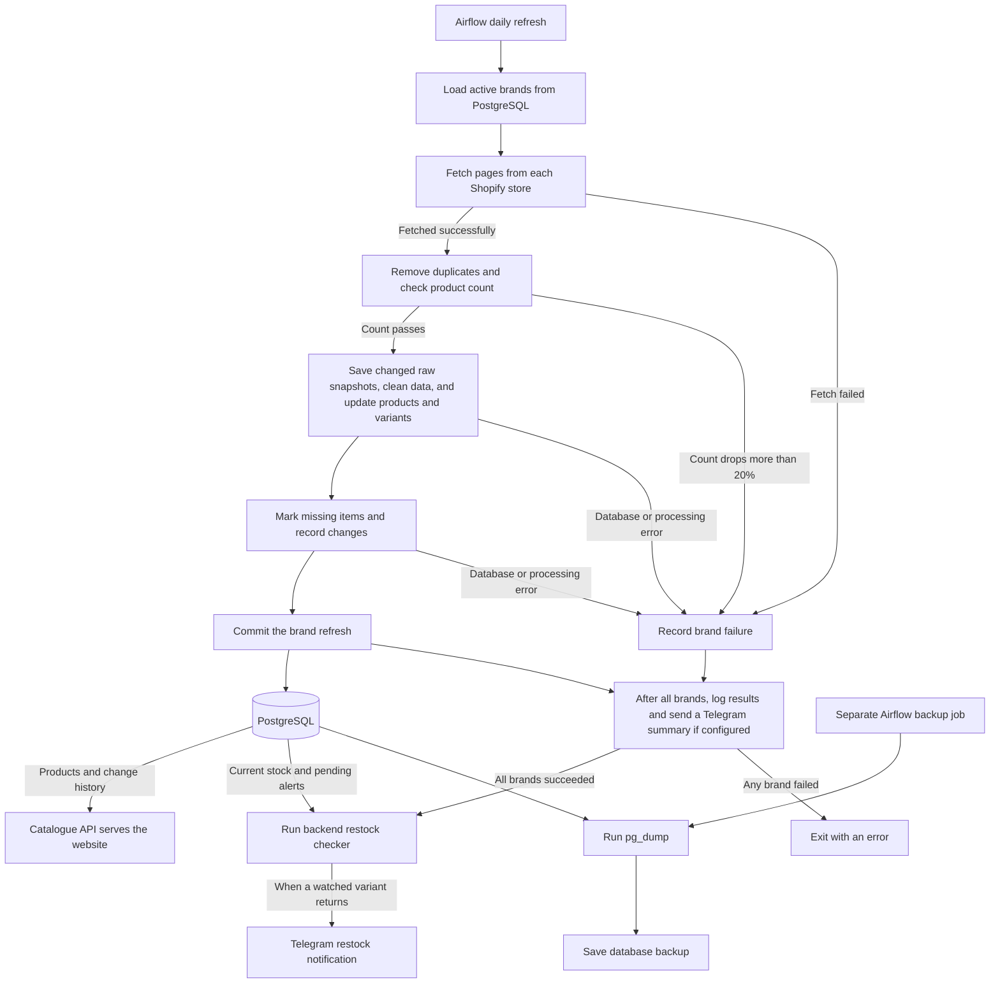

## What is the project?

The Catalogue pipeline collects product data from configured Shopify stores and prepares it for the website. It gives the API one consistent source for product details, prices, stock, and change history.

## What does it do?

- Fetches products from each active brand and stores a raw snapshot when a product's data changes.
- Standardizes sizes, categories, and prices. Marks variants inactive when they disappear and products inactive after two missed refreshes for their brand.
- Records new products, price changes, restocks, sold-out variants, removals, and relistings.
- Logs each run and sends a summary to Telegram when configured. A separate daily job backs up the database.

## How does it work?

Airflow schedules the daily refresh, which runs `python -m pipeline.run`. The Python job uses HTTPX to fetch pages from each store's public `/products.json` endpoint. It removes duplicates and skips a brand if the fetched count drops by more than 20% from the active count in the database.

The pipeline uses psycopg to save raw snapshots, cleaned products and variants, and change events in PostgreSQL. It compares the catalogue before and after each brand refresh and commits that brand's changes together. A failed brand leaves its data intact while the job continues with the other brands.

The API reads the saved catalogue. Airflow runs the backend's restock checker only when the full refresh succeeds. The backup runs independently.

## Working Flowchart

